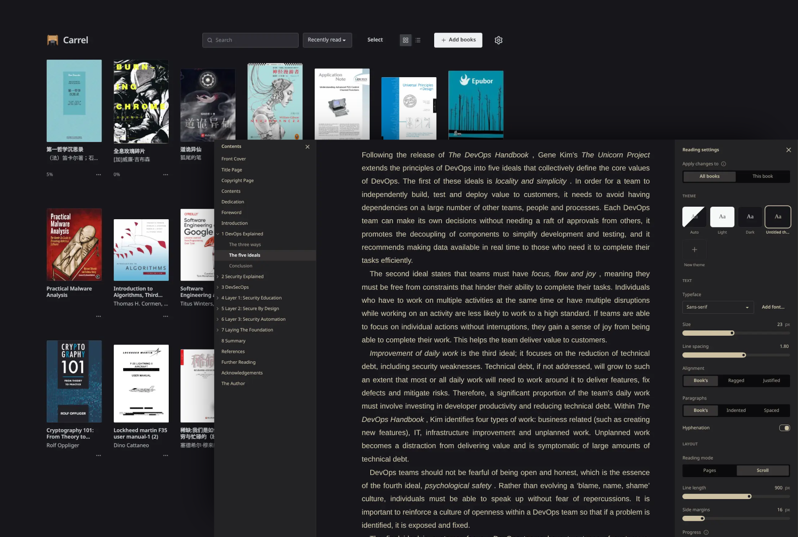

# Carrel 📖

An e-book reader that runs entirely in your browser. Your books are kept in the browser's own
storage and never leave your device: no accounts, no servers, no tracking.

Use it at [carrel.k4yt3x.com](https://carrel.k4yt3x.com), or host your own copy.



## Features

- **Formats:** EPUB, MOBI, AZW3, FB2, CBZ, PDF and plain text (TXT)
- **Library:** a grid of covers or a list; search, sort, and remove books in bulk
- **Reading:** paged or scrolled, one or two columns, full screen; search within a book,
  footnotes in a popup, a table of contents in a sidebar
- **Typography:** typeface, size, line spacing, alignment, hyphenation, margins, line length and
  custom CSS, for all books or just one
- **Themes:** light, dark, or your own colours
- **Fonts:** add your own, from files or a link (Google Fonts and the like)
- **PDFs and comics:** fit to page or to width, zoom, two pages side by side
- **Backup:** the whole library, with your place in each book and your settings, in one zip
  file, in case the browser clears its storage
- **Offline:** installable, and works with no connection once loaded. On iPhone and iPad, add
  it to the Home Screen from Safari (iOS 18 or later), where it keeps a library of its own
- **Private:** books can't run scripts or load anything from the internet

## Self-hosting

Carrel is a static site. Build it with Node.js 26 and [pnpm](https://pnpm.io):

```sh
pnpm install
pnpm build
```

Then serve `dist/` with any web server:

- At the root of a domain, such as `https://books.example.com/`, not under a path such as
  `https://example.com/carrel/`: PDF.js's files are loaded from `/vendor/pdfjs/`.
- Over HTTPS, or the app can't be installed or work offline.
- With `.mjs` files served as JavaScript, or PDFs won't open.

A fork can deploy itself to GitHub Pages: set Pages to deploy from GitHub Actions with a
custom domain (without one, Pages serves it under a path), let the `github-pages` environment
deploy from tags, and push a tag such as `1.0.0`.

## Development

```sh
pnpm dev          # development server at http://localhost:5173
pnpm lint
pnpm typecheck
pnpm test         # unit tests
pnpm test:e2e     # browser tests; run `pnpm exec playwright install chromium` once first
```

Changes are listed in [`CHANGELOG.md`](CHANGELOG.md).

## Credits

Carrel reads books with [foliate-js](https://github.com/johnfactotum/foliate-js) by John
Factotum, through [Readest's fork](https://github.com/readest/foliate-js), and PDFs with
Mozilla's [PDF.js](https://mozilla.github.io/pdf.js/). It is built on
[React](https://react.dev), [Dexie.js](https://dexie.org),
[zip.js](https://gildas-lormeau.github.io/zip.js/), [hash-wasm](https://github.com/Daninet/hash-wasm),
[Zustand](https://zustand.docs.pmnd.rs), [Workbox](https://developer.chrome.com/docs/workbox),
[Lucide](https://lucide.dev) icons, [Tailwind CSS](https://tailwindcss.com),
[daisyUI](https://daisyui.com) and [Vite](https://vite.dev).

## License

[MIT](LICENSE). The build lists the licenses of the libraries it includes in `licenses.md`.
